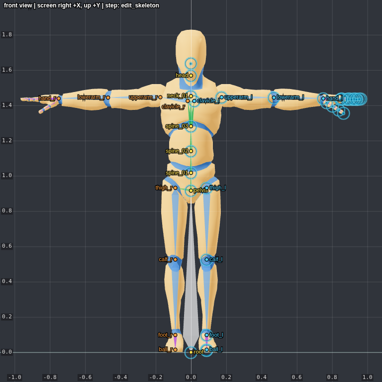
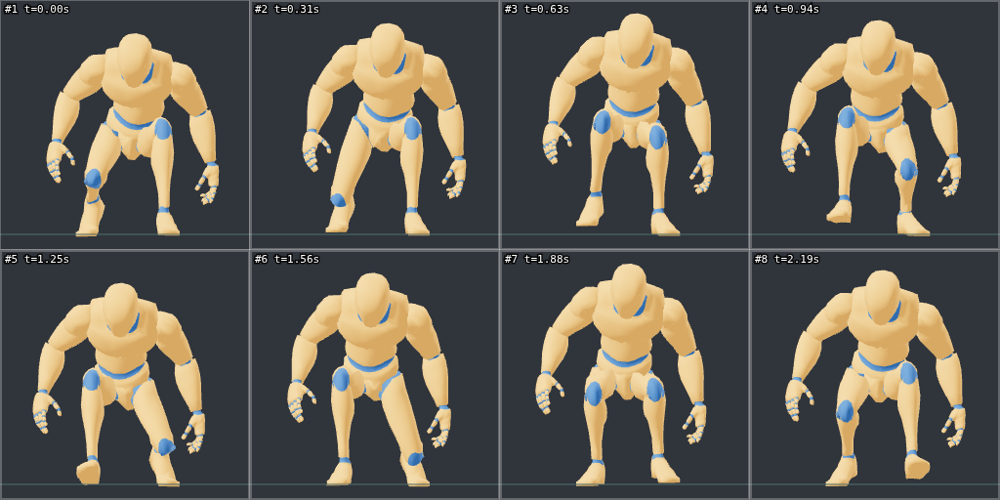

# Mesh2Motion MCP

An MCP server that lets an AI assistant rig and animate 3D models with [Mesh2Motion](https://github.com/Mesh2Motion/mesh2motion-app), the open source auto-rigging tool (think Mixamo, but for humans, foxes, birds, dragons, horses, spiders, snakes, fish and kaiju).

Load a static model, fit a skeleton template, place the joints, bind the skin, pick from the rig's animation library (178 clips for the human rig), attach props, and export a GLB or FBX. Rendered images with labelled joints and a coordinate grid let the assistant check its work at every step.

<table>
  <tr>
    <td align="center"></td>
    <td align="center"></td>
  </tr>
  <tr>
    <td align="center"><sub><code>screenshot</code> during joint placement</sub></td>
    <td align="center"><sub><code>animation_sheet</code> after binding</sub></td>
  </tr>
</table>

## How it works

Mesh2Motion is a browser app (TypeScript + three.js + WebGL), so the server runs the real app instead of re-implementing it:

```
MCP client ──stdio──▶ mesh2motion-mcp (Node)
                         │  Playwright
                         ▼
                headless Chrome/Chromium
                         │  window.m2m (bridge API)
                         ▼
          Mesh2Motion engine, built from the upstream repo
```

`npm run setup` clones the upstream repository into `vendor/mesh2motion-app`, adds one extra page (`mcp-bridge.html`, a copy of the app's create page that boots the engine through [`bridge/McpBridge.ts`](bridge/McpBridge.ts)) and builds it with the app's own Vite toolchain. The bridge calls the engine's steps directly, records the app's error dialogs, and renders captures with temporary cameras. Between tool calls it pauses the app's render loop and preview videos, so an idle server doesn't keep drawing a page nobody sees (with SwiftShader that costs several CPU cores). Nothing in the upstream code is modified, so updating the app is a `git pull` and a rebuild.

## Requirements

- Node.js 20 or newer, npm and git
- A Chromium-based browser. Google Chrome or Microsoft Edge are used when installed. Otherwise Playwright's Chromium is downloaded automatically, once, into `~/.cache/ms-playwright` (about 400 MB on disk). This happens during `npm run setup`, or when the server starts if it is still missing then. On a minimal Linux server Chromium may also need its system libraries: `sudo npx playwright install-deps chromium`.
- WebGL works without a GPU through SwiftShader, so it also runs on servers and over SSH
- Optional: [Blender](https://www.blender.org) for `reweight_with_blender` (tested with 4.0). It is found on `PATH`, in the default macOS/Windows install location, or through `M2M_BLENDER`

## Setup

```bash
npm install
npm run setup
```

`setup` compiles the server, clones and builds Mesh2Motion (about 70 MB of assets) and checks for a browser. Then check everything end to end:

```bash
npm run smoke
```

It rigs the sample human, renders a few images and exports a GLB and an FBX into `output/smoke-test/`.

### Claude Code

To make the server available in every project, run this from the mesh2motion-mcp folder:

```bash
claude mcp add --scope user mesh2motion -- node "$PWD/dist/index.js"
```

To enable it for a single project instead, create a `.mcp.json` file in that project's root folder. Use the absolute path of `dist/index.js` on your machine:

```json
{
  "mcpServers": {
    "mesh2motion": {
      "type": "stdio",
      "command": "node",
      "args": ["/path/to/mesh2motion-mcp/dist/index.js"],
      "env": {}
    }
  }
}
```

Settings from the [environment variables](#environment-variables) table go in `env`, for example `"env": { "M2M_OUTPUT_DIR": "/home/me/exports" }`. Claude Code asks you to approve a project's `.mcp.json` servers the first time it opens the project. Running `claude mcp add --scope project mesh2motion -- node /path/to/mesh2motion-mcp/dist/index.js` from the project folder writes the same file for you. `.mcp.json` holds a path that only exists on your machine, so this repository doesn't ship one and ignores it.

### Claude Desktop and other clients

Add the server to the client's MCP configuration (for Claude Desktop: Settings → Developer → Edit Config):

```json
{
  "mcpServers": {
    "mesh2motion": {
      "command": "node",
      "args": ["/path/to/mesh2motion-mcp/dist/index.js"]
    }
  }
}
```

### Environment variables

| Variable | Default | Purpose |
| --- | --- | --- |
| `M2M_OUTPUT_DIR` | `./output` | Where relative export and screenshot paths are written |
| `M2M_HEADLESS` | `1` | `0` opens a visible browser window so you can watch the app work; its render loop keeps running between tool calls |
| `M2M_BROWSER_CHANNEL` | auto | Force `chrome`, `msedge` or `chromium` (Playwright's Chromium only). Auto: Playwright Chromium if installed, then Chrome, then Edge, then download Chromium |
| `M2M_AUTO_INSTALL_BROWSER` | `1` | `0` never downloads Chromium; the server reports an error when no browser is found |
| `M2M_APP_DIR` | `./vendor/mesh2motion-app` | Use another Mesh2Motion checkout (setup builds it in place) |
| `M2M_APP_REF` | default branch | Branch, tag or commit to build (setup only) |
| `M2M_APP_REPO` | upstream GitHub | Fork to clone (setup only) |
| `M2M_BLENDER` | auto | Blender executable for `reweight_with_blender`. Auto: `blender` on `PATH`, then the default macOS/Windows install location |

## Tools

The pipeline is a sequence of steps; tools say which step they need and what to call first when used too early.

| Step | Tool | What it does |
| --- | --- | --- |
| any | `status` | Current step, model, skeleton, animation state, recent app dialogs |
| any | `list_catalog` | Rig types, sample models, hand options, prop ids, export options |
| any | `load_model` | Fresh session + import a `.glb`, `.fbx`, `.zip` (glTF with bin/textures) or a sample model |
| any | `reset` | Reload the app |
| load_skeleton | `transform_model` | Rotate, scale, set height, center, put on the floor (baked into the mesh) |
| load_skeleton+ | `analyze_model` | Mesh slices with solid spans per height, to find crotch, shoulders, neck… |
| load_skeleton | `select_skeleton` | Rig type, hand setup, scale (`"auto"` fits the rig's reference model) with live preview |
| load_skeleton | `confirm_skeleton` | Load the rig and start editing joints |
| edit/animations | `get_bones` | Bones with parent, world joint position and mirror counterpart |
| edit_skeleton | `auto_place_joints` | Human in T-pose: fits all joints to the mesh shape; optional chin/groin/wrist/elbow/knee markers |
| edit_skeleton | `set_bones` | Absolute positions, offsets or rotations; mirrors left/right; children follow or stay |
| edit_skeleton | `edit_history` | Undo / redo joint edits |
| edit_skeleton | `set_skinning_options` | Head and arm weight corrections (human), weight-paint preview |
| edit_skeleton | `bind_skin` | Compute weights, create the skinned mesh, load the animation library |
| animations | `go_back_to_step` | Back to joints (kept) or to rig selection |
| animations | `list_animations` | Names and durations, with a word filter |
| animations | `play_animation` | Play, or freeze at a time for a screenshot |
| animations | `animation_sheet` | N frames of an animation in one image, fixed camera |
| animations | `set_animation_options` | Mirror all animations, A-pose arm correction (human) |
| animations | `set_props` | Weapons and tools in either hand (human, kaiju) |
| animations | `import_animations` | Add custom `.glb` animations made for the same rig |
| animations | `export` | GLB or FBX (Unreal/Unity preset), mesh or skeleton only, Mixamo bone names (human), per-clip mirroring |
| after export | `reweight_with_blender` | Replace the skin weights of an exported GLB with Blender's automatic weights (needs Blender) |
| any | `screenshot` | Front/back/left/right/top/bottom (orthographic, with a world grid) or perspective; joints drawn with names |

Coordinates are world space: Y up, the character faces +Z and its own left side is +X. In screenshots, cyan joints are on the left side, orange on the right, yellow on the center line.

### Smoother weights with Blender

Mesh2Motion gives every vertex to its closest bone and blends only a few rings of vertices at each boundary, and not at all on hands and feet. On generated meshes, where fingers are fused and clothing is part of the body, that shows when joints bend far: curled fingers break into spikes and a tunic can split between the legs.

`reweight_with_blender` takes a GLB written by `export` and recomputes the weights in Blender with its automatic weights (bone heat diffusion), which blend smoothly through the volume. It runs [`scripts/blender_reweight.py`](scripts/blender_reweight.py) in a background Blender, without touching the live session:

- Every bone deforms except the tip markers (`*_leaf`, the finger stub of a single-bone hand) and an unweighted root. The heat solve uses a temporary copy of the skeleton whose bones run from each joint to its child joint, because the imported bones don't point along the limbs.
- Vertices the heat solve can't reach (detached pieces such as eyes) keep their Mesh2Motion weights; the result reports how many.
- Joint names, bind pose (inverse bind matrices) and animations stay as exported. Without an animation playing, the file now shows the bind pose; Mesh2Motion leaves the bones in an animation frame.

On Linux, distribution builds of Blender find their Python through the `python3` on `PATH`, so a conda or pyenv Python placed first breaks Blender's glTF add-on. The server starts Blender with `/usr/bin` and `/bin` first on `PATH`, and with `--factory-startup` so user add-ons don't load.

## Example session

> Rig `~/models/knight.glb` as a human, make sure the elbows and knees line up, then export it as FBX for Unity with an idle, a walk, a run and a sword attack.

A typical run:

1. `load_model {path}` → `transform_model {align_to_floor, center_xz}` if needed
2. `select_skeleton {type: "human", scale: "auto"}` → `screenshot {view: "front"}`
3. `confirm_skeleton` → `auto_place_joints` → `screenshot` front and left; fix single joints with `set_bones` (e.g. `{"name": "lowerarm_l", "position": [0.48, 1.41, -0.03]}`, mirrored to `lowerarm_r`)
4. `set_skinning_options {preview: "weights"}` + `screenshot` to inspect the influence areas
5. `bind_skin` → `list_animations {filter: "sword"}` → `animation_sheet {name: "Sword_Attack"}`
6. `export {output_path: "knight", format: "fbx", fbx_preset: "unity", animations: ["Idle", "Walk", "Run", "Sword_Attack"]}`
7. Optional, with Blender installed: export as GLB, then `reweight_with_blender {input_path: "knight.glb"}` writes `knight-blender.glb` with smoother weights

## Keeping Mesh2Motion up to date

```bash
npm run setup-app -- --update        # git pull + rebuild
M2M_APP_REF=<tag-or-commit> npm run setup-app -- --update
```

If an upstream change breaks the bridge, the smoke test shows which step fails. Bridge code lives in `bridge/`; after editing it run `npm run rebuild-bridge`.

## Development

```bash
npm run build            # compile the server (src/ → dist/)
npm run rebuild-bridge   # copy bridge/ into the app and rebuild it
npm run smoke            # end-to-end test through an MCP client
npm run inspect          # MCP Inspector UI
node scripts/smoke-test.mjs --model path/to/model.glb --type fox
```

## Limitations

- One session per server process: the app is a single stateful 3D scene, so tool calls are queued.
- Mesh2Motion's separate retargeting page (moving its animations onto an already rigged model) is not exposed yet.
- Exports always contain at least one animation; that is how Mesh2Motion's exporter works.
- Joint placement is not automatic in Mesh2Motion itself. `auto_place_joints` covers the human rig in a T-pose. Other rigs and poses are placed from screenshots, `get_bones` and `analyze_model`.
- `reweight_with_blender` reads and writes GLB only, and its result is a file: it is not loaded back into the session, so screenshots and animation sheets still show Mesh2Motion's weights.

## How `auto_place_joints` works

The mesh surface is sampled evenly and cut into thin cross-sections: horizontal slices for legs, torso and neck, vertical slabs along each arm. The joints come from where those sections change shape:

- **Arms**: each arm is followed from the fingertips inward until it merges into the torso. The armpit is where the underside of the arm drops away into the side of the torso, and the shoulder joint sits there. The wrist is the narrowest section (front to back) before the palm widens. The elbow is the narrowing between biceps and forearm.
- **Legs**: the crotch is where the legs split at the midline. The hips sit at a fixed fraction of the shoulder height and above the crotch. The knee is the narrowest leg section, and the ankle sits just above where the front of the leg flares into the foot. Heel and toe come from the lowest slices.
- **Head**: the neck is the narrowest section between the shoulders and the top, with the head joint there and `head_leaf` at the top.
- **Spine and fingers** keep the rig's own spacing. The fingers are scaled to the measured hand length and width.

Where a shape is ambiguous (a coat over the crotch, a helmet without a neck, low-poly arms without an elbow narrowing) the joint falls back on the rig's proportions. The result's `sources` and `notes` list these fallbacks. The constants were tuned on the human variants that ship with Mesh2Motion: the average error against their hand-placed joints is about 1.5–2% of the character height.

## Credits

[Mesh2Motion](https://mesh2motion.org) by the Mesh2Motion contributors: code under MIT, models, rigs and animations under CC0. This server only automates it; support the project at <https://support.mesh2motion.org/>.
